# Geboortewandeling

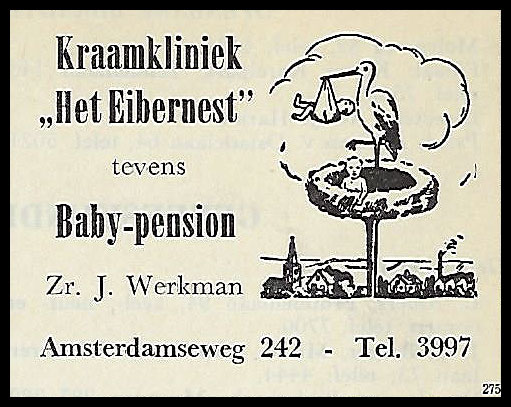

# Ten geleide: Haarlemmermeerpolder

De totale oppervlakte van de Haarlemmermeerpolder is ongeveer 18.500 hectare (oftewel 185 $km^2$). In moderne oppervlaktemeten is dat plusminus 25.000 voetbalvelden.

De Haarlemmermeerpolder zelf past ongeveer 2,5 keer in de Noordoostpolder en de Noordoostpolder 2 keer in de Flevopolder. Dan lijkt de Haarlemmermeerpolder opeens verrassend klein. In werkelijkheid is hij erg  groot.

De Haarlemmermeerpolder werd in de jaren vijftig van de negentiende eeuw drooggelegd met drie grote stoomgemalen: De Leeghwater, De Lynden en De Cruquius.

De Lynden is nu een restaurant, De Cruquius een museum en De Leeghwater een dieselgemaal dat zelden meer wordt gebruikt.

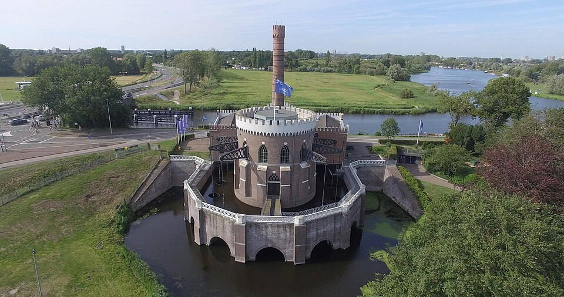
> De Cruquius

Behalve De Leeghwater pompen nog drie andere gemalen het water de Haarlemmermeerpolder uit: Gemaal Koning Willem I, Gemaal Lynden (niet te verwarren met het restaurant) en Gemaal De Bolstra. We gaan ze allemaal niet zien.

Na de drooglegging van het Haarlemmermeer werd Amsterdam niet meer bedreigd door het steeds woestere water maar was het ook zijn bescherming tegen vijandelijke legers kwijt. Er werden dus nieuwe forten gebouwd, alle onderdeel van de Stelling van Amsterdam. Het is verleidelijk om Fort Schiphol daar ook toe te rekenen maar dat fort werd al gebouwd toen de Haarlemmermeer nog _het_ Haarlemmermeer was en men doende was de ringdijk met bijbehorende -vaart te graven en op te werpen. Waar een sloot genaamd _Schips Hol_ de vers gegraven ringvaart bereikte, bouwde men een defensieve toren die uitgroeide tot Fort Schiphol. In 1916 landde er, als onderdeel van een militaire oefening, voor het eerst een vliegtuig in de wei. Daarmee werd Schiphol na Soesterberg de tweede luchthaven van Nederland.
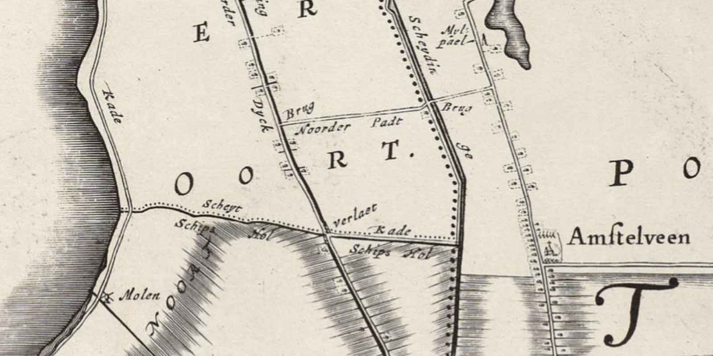
> Een sloot genaamd _Schips Hol_. Let ook even op het woord _Mijlpaal_ rechtsboven. Ik ga daar nog op terug komen.

Vanaf 1920 was Schiphol een burgerluchthaven. In 1924 werd het eigendom van de gemeente Amsterdam. In juni 1928 werd het iconische _Stationsgebouw_ opgeleverd. Men had de bedoeling de sporters van de Olympische Spelen Amsterdam in stijl te verwelkomen. Die bleken echter allemaal de voorkeur te geven aan boot of trein met als argument: 'Het is pas 1928. Het luchtvaarttijdperk moet nog aanbreken.'

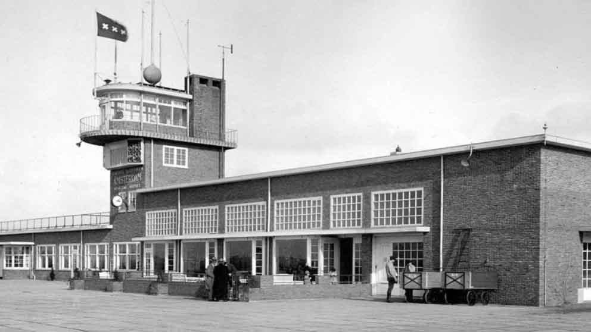

> Luchtreizigers kwamen in 1928 na het verlaten van het vliegtuig aan in een stationsgebouw. Daarna ging het per KLM-bus naar Amsterdam.

# De wandeling

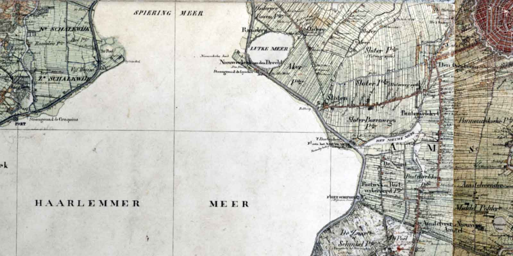

Geen zorg. We gaan niet zwemmen. Het hier gedeeltelijk afgebeelde Haarlemmer Meer -- een bij elke storm verder uitdijende hoeveelheid veenafgravingen tussen Amsterdam, Haarlem en Leiden -- werd halverwege de negentiende eeuw wijselijk drooggelegd.

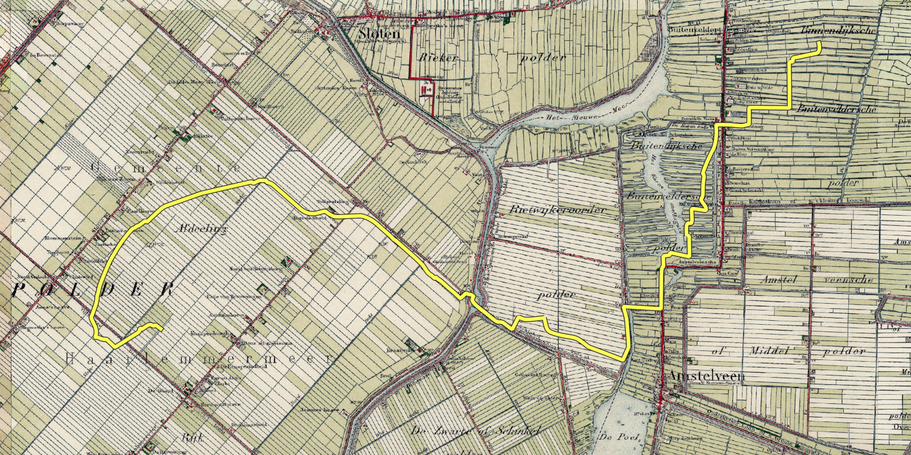

Dat ziet er al beter uit. Ik heb de wandeling met de markeerstift aangegeven. Waar die de Ringvaart kruist, ongeveer in het midden van de kaart, stond Fort Schiphol -- een vierkantige uitstulping in de ringvaart. Op het kaartje van het nog vloeibare Haarlemmermeer is het ook al herkenbaar.

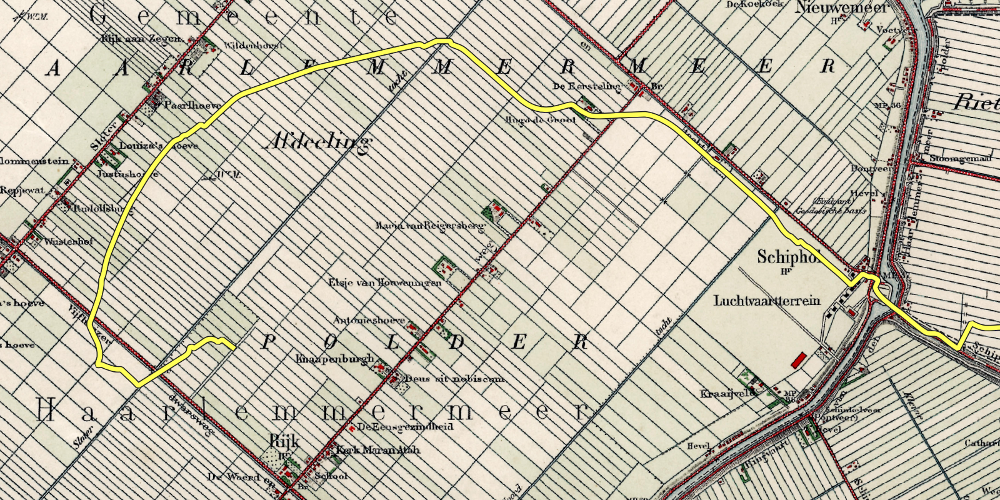

Zoek de verschillen. Ja, ik zie er één! Boer Knibbe heeft in 1916 zijn weiland verkocht aan de Nederlandse overheid. Die heeft er heel optimistisch _Schiphol Luchtvaartterrein_ op geschreven en een paar schuren gebouwd. Geland en opgestegen wordt er in de richting die de piloot het gunstigst lijkt. De ondergrond is grassig en drassig. De Franse aviatiewereld spreekt al snel van "Schiphol-les-Bains"

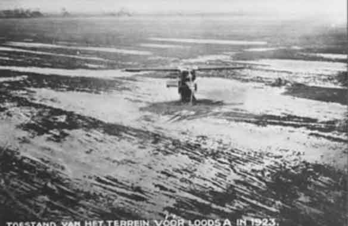
> _Schiphol-les-Bains_

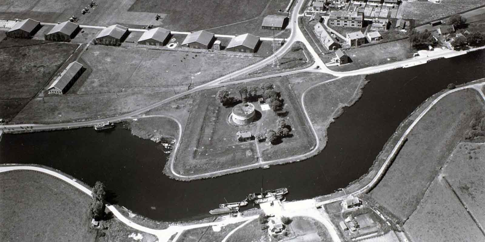

> Schiphol op een zonniger dag. We zien het fort langs de ringvaart en een handvol vliegtuigschuren. Foto uit  1925.

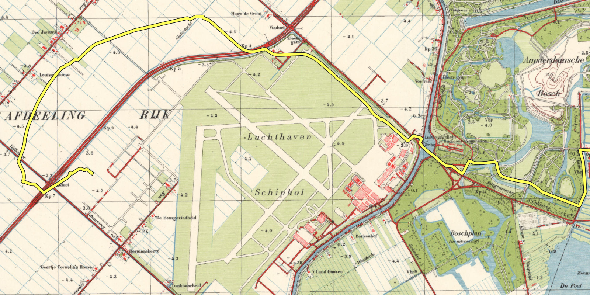

Tijdsprong. In de Tweede Wereldoorlog wordt Schiphol compleet vernietigd maar in 1945 herrijst het binnen enkele weken. In de jaren 50 liggen er minstens vier serieuze start- en landingsbanen in elk van de acht windrichtingen. Kenners zien hier al vroege versies van de Oostbaan (evenwijdig aan de bebouwing) en in noord-zuidrichting de Aalsmeerbaan, die de westgrens vormt van het luchthaventerrein. Fort Schiphol is gesloopt om plaats te maken voor een brug over de ringvaart. Daar kunnen we dan mooi overheen wandelen. Aan de overzijde is namelijk dankzij de Werkverschaffing van de jaren dertig een wandelgebied genaamd _Amsterdamsche Bos_ gegroeid.

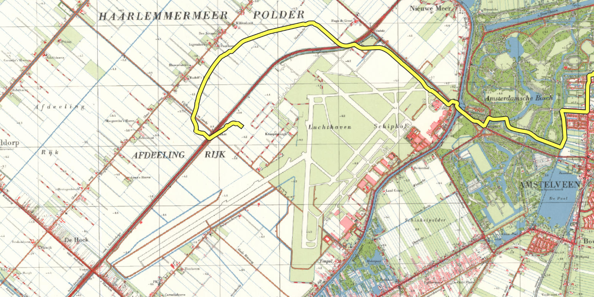
1960. In het zuidwesten is de Kaagbaan verschenen. Die wijst naar de  Kager Plassen zoals de Aalsmeerbaan naar Aalsmeer wijst. Kijk nog maar even goed naar Rijksweg 4 waar de Amsterdammer met een slinger om Schiphol heen moet, want die slinger maakt straks plaats voor een nog veel grotere slinger zodat onze wandelroute opeens zinvol lijkt.

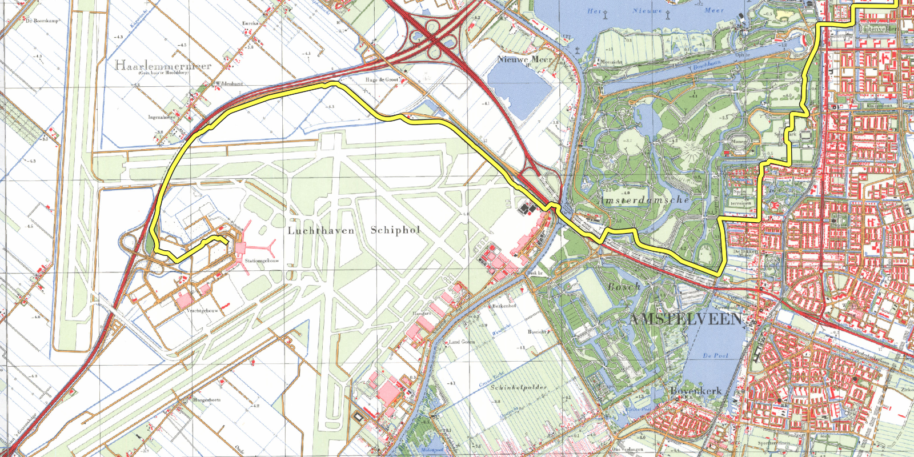
Ik voorspelde het al. Er is een Buitenveldertbaan aangelegd, ondertunneld door een Schipholtunnel waarin de geheel vernieuwde, nu nóg betere Rijksweg 4 onderdak heeft gevonden. Het is 1967 en alles moet anders. In het westen van Schiphol, omsingeld door Aalsmeer, Kaag- en Buitenveldertbaan, staat een geheel nieuw vliegtuigstation, naar de heersende mode 'passagiersterminal' genoemd.

De westgrens van het vlieggebeuren wordt nu gevormd door de 'Vierde Baan' (Zwanenburgbaan). De Oostbaan is er ook nog maar  wordt door Schiphol buiten de banenstatistiek gehouden.

Het afgedankte vliegtuigstation _Schiphol_, bij het voormalige _Fort Schiphol_, bij de kwijtgeraakte sloot _Schips Hol_, staat er verloren bij. Het is vanaf nu bedrijventerrein. De Oostbaan blijft in gebruik voor het ontvangen van privéjets, helikopters en Extinction Rebellion.

In het kader van het polderwandelen mag ook de Polderbaan niet ongenoemd blijven. Die werd geopend in 2003, zó ver naar het westen dat hij niet op de kaart past, en is een eigen wandeling waard.

# Amsterdamse Bos

Bij de Schipholdraaibrug gedenken we korte tijd het verloren gegane Fort Schiphol. Dan gaat het verder het Amsterdamse Bos in. Aanvankelijk had deze route als werktitel _Olympische Spelen 1928_ maar dat is vervangen door: _Rijksweg 9, segment Ouderkerk aan de Amstel - Aalsmeer, bezien vanuit het standpunt van een pasgeborene_.

Het is wegens de aanleg van deze Rijksweg dat ik in Amstelveen ben geboren, aan de rand van het Amsterdamse Bos, waar _Rijksweg 9, segment Ouderkerk aan de Amstel -  Aalsmeer_ dwars doorheen loopt. Het Bos is ongeveer drie keer zo klein als Schiphol en Schiphol weer negen keer zo klein als de Haarlemmermeerpolder. Hoe groot de Haarlemmermeerpolder is, heb ik hierboven besproken.

Het deel van het Bos waarmee wij ons zullen bezighouden, bevindt zich in de _Rietwijkeroorderpolder_ -- op oudere kaarten: _Rykeroord_,  vernoemd naar het  in de  zeventiende eeuw door het  Haarlemmermeer verzwolgen dorp Rietwijk (of: Rijk). 

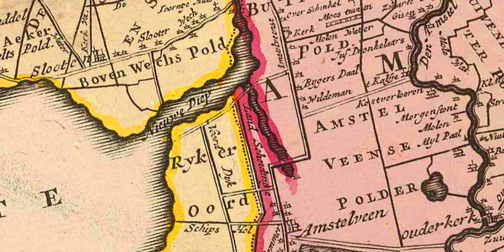

De polder maakt deel uit van het Rijnland -- een enorm Hoogheemraadschap, dat reikt van hier helemaal tot aan De Leidsche Dam in Leidschendam. Daar grenst het aan  ons  eigen Delfland.

Op bovenstaande kaart uit 1745 zien wij een andere landscheiding: die  tussen het Rijnland en het _Amstelland_. Schips Hol ligt in het Rijnland (geel); Amstelveen in het Amstelland (rood). Ik besteed hier extra aandacht aan omdat ik erg geïnteresseerd ben in landscheidingen. Groot was mijn vreugde toen mijn nieuwe polderwandelhobby leidde tot de ontdekking dat ik zo ongeveer _óp_ de landscheiding Rijnland-Amstelland ben geboren. Mijn geboortehuis bevindt zich aan de Amsterdamseweg die van Amstelveen noordwaarts op de rand van het Amstelland loopt. Het water dat wordt overbrugd grenst aan de achtertuin van het geboortehuis. Het gaat om het _Karnemelksgat_: een langgerekte waterpartij, ooit gevormd toen de dijk langs het Nieuwe Diep doorbrak en die vervolgens werd gebruikt als transportroute voor karnemelk. Althans: dat suggereert de naam.

Dat Nieuwe Diep is op zijn beurt weer een uitdijende voortzetting van het Haarlemmer Meer. Zo won het water bij elke storm meer terrein en bedreigde het Amsterdam. Vandaar het besluit het Haarlemmer Meer in te polderen. Het Nieuwe Diep bleef gespaard ten behoeve van de scheepvaart naar Amsterdam. Tegenwoordig heet het het (of: de) _Nieuwe Meer_ en is het, net als het Amsterdamse Bos, een recreatiegebied.

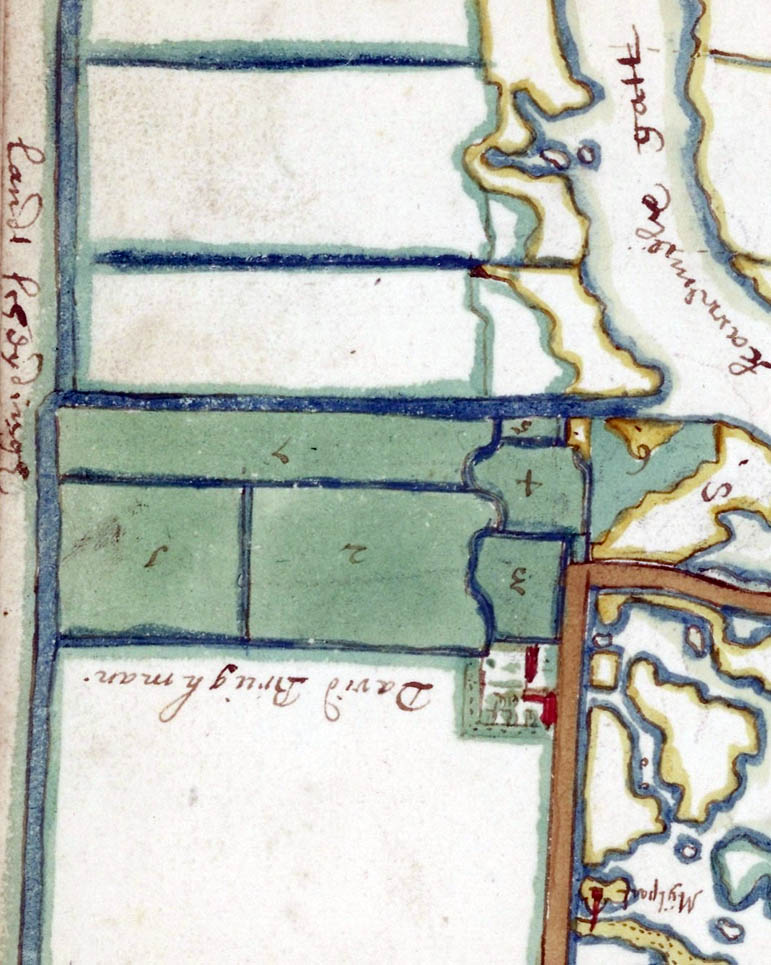

Bij kaarten waarop het zuiden boven is en het noorden onder, is er altijd een dilemma: keren we de kaart om of niet? Ik heb bij deze kaart uit 1680 tot omkeren besloten. De mededelingen staan nu ondersteboven maar het verband met de vorige kaart is duidelijker. We zien de Amsterdamseweg aan het Karnemelksgat, waar zich in dat gat een drassige archipel bevindt. Het rode object dat onderaan de kaart in de berm van de weg staat is een mijlpaal of banpaal. Die geeft aan waar, op precies één Duitse mijl van de stadsmuren, het rechtsgebied (de _banne_) van Amsterdam eindigde.

Niet ver bij de banpaal vandaan werd pluminus 250 jaar later mijn geboortehuis gebouwd, nog nét binnen de bescherming van het veilige Amsterdam  maar er beslist geen deel van. Dat kun je afleiden uit de naam Amsterdamseweg. (Twee bochten verder heet die opeens Amstelveenseweg. Daar begint kennelijk Amsterdam. Het verbindende bajonetstukje heet de Schinkel -- Oud-Nederlands voor 'scheenbeen', niet te verwarren met allerlei andere scheenbenige dingen in Amstelland die ook Schinkel heten, zoals de waterweg De Schinkel die de voortzetting is van het/de Nieuwe Meer richting het IJ.)

Tegenover mijn geboortehuis (hier nog niet gebouwd) zien we de boerderij van David Brughman die hier de enige zichtbare bebouwing op de kaart vormt. Zijn landerijen zijn groen gekleurd en genummerd want hij pachtte van een Gasthuis en de Gasthuizen maakten kaarten zoals deze om de opbrengst hun bezittingen te administreren. Van die opbrengst bekostigden ze de armenzorg. Een Duitse mijl is 7,5 kilometer.

Onder Napoleon, die de gemeentes uitvond, werd dit allemaal de Gemeente Nieuwer-Amstel -- aan de overkant van de Amstel ligt Ouder-Amstel. Ook in de stad Amsterdam noemt men de oostoever van de Amstel Oudezijds en de westoever Nieuwezijds maar dat heeft niets met elkaar te maken.  
Zeggen ze.

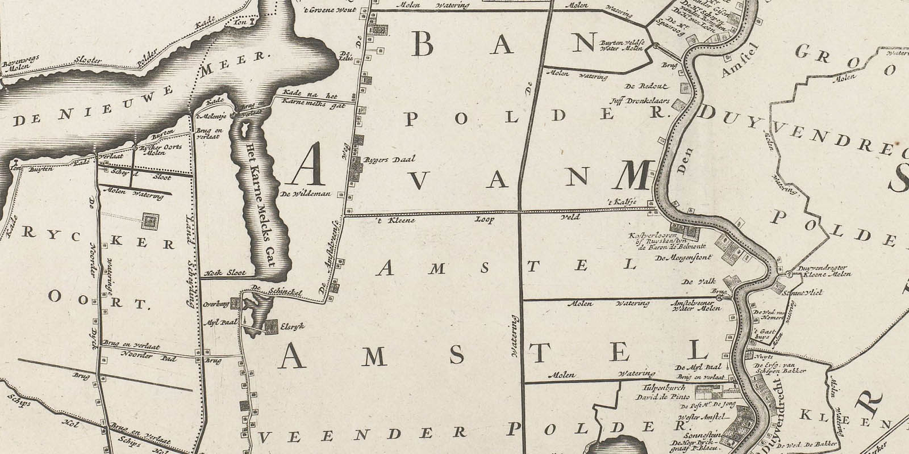
Deze kaart geeft nog wat context aan onze wandeling. Schips Hol in het hoekje linksonder. Onze route volgt, na een ommetje door het Amsterdamse Bos, globaal het thans vrijwel verdwenen Karnemelksgat naar het noorden. Van de Amstel (rechts) blijven we ver verwijderd. Van Amsterdam iets minder ver maar zo lang we in het Amsterdamse Bos zijn, zijn we nog steeds in de gemeente Amstelveen, zoals Nieuwer-Amstel sinds 1964 heet.

De polders in dit gebied zijn de hier afgebeelde Amstelveender- of Middenpolder in het zuiden en, niet op de kaart, de meer noordelijk gelegen Buitenveldse Polder. Buitenveld was een buurtschap aan de Amstelveense Weg. Het volledige gebied heette de _Ban van Amstelveen_. Zo zien we dat de namen die hier gelden, voortborduren op twee thema's: een _veen_-gebied aan de _Amstel_ en een _buiten_ de Amsterdamse stadspoorten gelegen _veld_.

# Buitenveldert
Vanaf 1958 werd de Buitenveldsche Polder opgevuld met een tuinstad die vooral bekendheid zou verwerven als aanvliegroute van Schiphol, onderkomen van de Vrije Universiteit Amsterdam en, in de jaren 70, als woonomgeving van de minister-president. Hier woont de elite die de Grachtengordel en Oud-Zuid te aanstellerig vindt maar wel graag nabij een universiteit of zakencentrum woont. Amstelveen is dan weer meer iets voor luchtvaartpersoneel en mensen die er toevalllig moeten zijn omdat ze een snelweg komen aanleggen.

# Wat we  ook  nog  tegenkomen
## Bocht van Thijsse
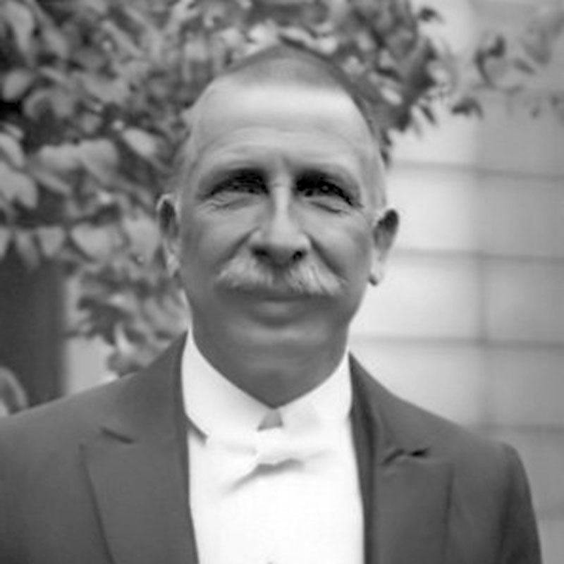
Deze goedlachse man is vogelaar en algemeen natuurliefhebber Jac. P. Thijsse. Naar hem zijn in deze omgeving enkele aan de natuur gerelateerde dingen vernoemd. Als onderwijzer wandelde hij graag met zijn leerlingen door de buitenveldse buitenvelden tussen de ene Schinkel en de andere Schinkel in. Hij publiceerde pleidooien voor de aanleg van een bos bij het Nieuwe Meer en wordt daarom beschouwd als de geestelijk vader van _het Boschplan_ dat in de jaren dertig werd verwerkelijkt.

Dat het _Bosch_ niet naar Thijsse is vernoemd is een groot onrecht. Extra pijnlijk is dat men heeft gekozen voor de naam _Amsterdamsche Bosch_ terwijl het bos helemaal niet in Amsterdam ligt. Wie betaalt, bepaalt.

Thijsse moest het intussen doen met de naamgeving van een kreekbocht. (Niet eens van de volledige kreek.) In de omgeving zijn er ook nog enkele parken naar hem vernoemd, en een ecoduct en een bankje bij het Nieuwe Meer.

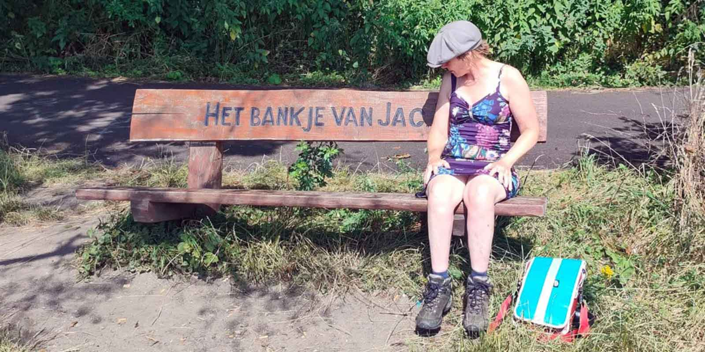
> Een bankje bij de Nieuwe Meer.

## KLM-hoofdkantoor
Gelegen aan de Landscheiding.  
In gebruik sinds 1971.  
De plattegrond heeft de vorm van een vliegtuig.  

Ik heb het natuurlijk over het hoofdkantoor van de KLM, gebouwd naar een ontwerp van Rein Fledderus, die ook verantwoordelijk kan worden gehouden voor de Doelen in Rotterdam en volgens mij ook voor het naargeestige _Plan Fledderus_ in de Delftse Buitenhof. 

Eerdere KLM-hoofdkantoren stonden in Den Haag, waar KLM-oprichter Plesman vandaan kwam; de eerste paar jaar boven Theater Heerengracht (het latere Odeon); vanaf eind jaren 30 aan het Sint-Hubertuspark.

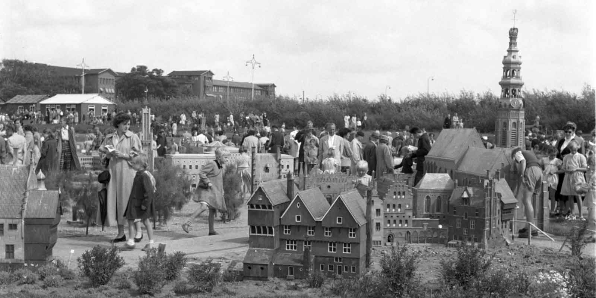
> Het enorme KLM-hoofdkantoor aan het Sint-Hubertuspark met op de voorgrond enkele kleinere gebouwen.

Plesman, zoon van een Haagse eierboer, rolde via een carrière in het leger de vliegtuigwereld in. Hij was geen liefhebber van Amsterdam en al helemaal niet van het drassige Schiphol. Liever had hij het Rotterdamse vliegveld _Waalhaven_ tot nationale luchthaven zien uitgroeien, of nog beter: een nieuw te bouwen luchthaven bij Leiderdorp. Lekker centraal. Dat hij in de jaren 30 het KLM-hoofdkantoor in Den Haag liet bouwen is ook al een teken dat hij Schiphol voor de toekomst van de Nederlandse luchtvaart geen bijzondere rol toedichtte.

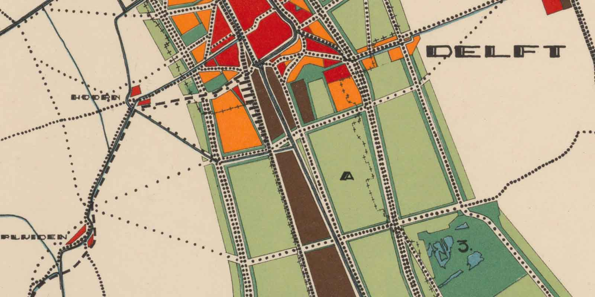

> Ook Delft was in het interbellum kandidaat om _Vliegveld Holland_ te gaan huisvesten. Volgens de legenda bij dit uitbreidingsplan uit 1929 staat de kapitale A in het midden voor 'gereserveerd voor vliegveld'.

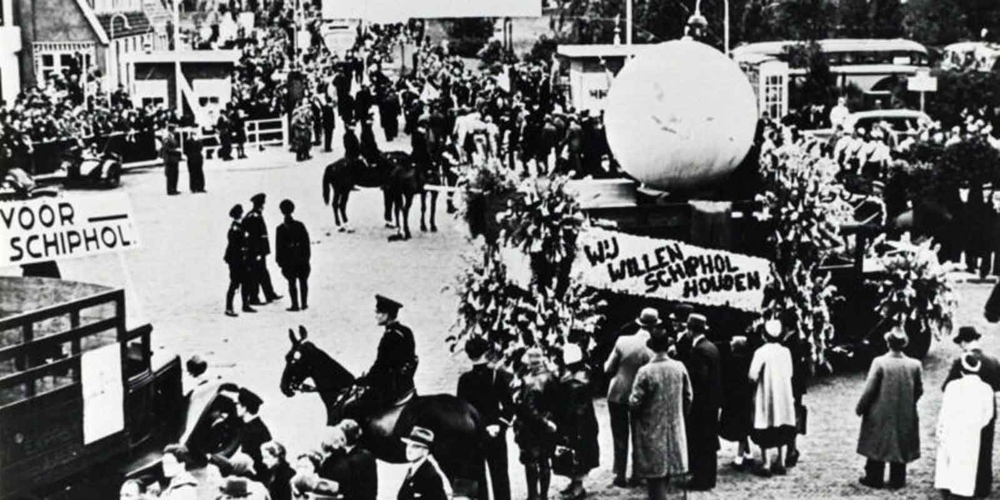
> 2 juli 1938. Er heerst een grimmige sfeer op het Schipholluchthaventerrein. Aalsmeerders dreigen met bloemen. Charmezanger Bob Scholte brengt een protestlied ten gehore ("Wij willen Schiphol houden"). De plannen voor een nieuw te bouwen nationaal vliegveld bij Leiderdorp zijn de oorzaak van alle onrust. Een Wereldoorlog later blijken de alternatieve plannen niet meer haalbaar: Schiphol wordt nationale luchthaven.

## VRA

Het terrein van VRA Amsterdam (een samengaan van de cricketclubs Volharding, Run, Amstels en Progress) is _de_ Nederlandse A-locatie voor internationale cricketwedstrijden. Het heeft alles wat een cricket ground nodig heeft: een graswicket, lokale kakkers, een boom op het veld en elke tien minuten een laag overscherend straalvliegtuig. 

## Bosbaan

Volgens het oorspronkelijke thema van deze wandeling _Olympische Spelen 1928_ zouden we na Schiphol een heel end langs de Bosbaan lopen en daarna naar het Olympisch Stadion. Naar mijn stellige overtuiging landden de Olympiërs destijds op het pas vernieuwde Schiphol en werden de roeionderdelen op de speciaal voor die gelegenheid gegraven Bosbaan gehouden. Inmiddels weet ik dat de sporters zo een vliegreis helemaal niet zagen zitten. Vliegen werd in 1928 nog steeds gezien als iets militairs of als extreme sport. En de Bosbaan werd pas vanaf 1934 gegraven. In 1928 roeiden de Olympiërs op de Ringvaart nabij Sloten. Bleef over: een rondje om het Olypisch Stadion lopen en dan weer naar huis. Te weinig voor een serieuze wandeltocht dus het thema _Olympische Spelen 1928_ ging -- zoals men dat in de roeiwereld noemt -- overboord, en de geboortehuiswandeling werd geboren.

# Zuidas

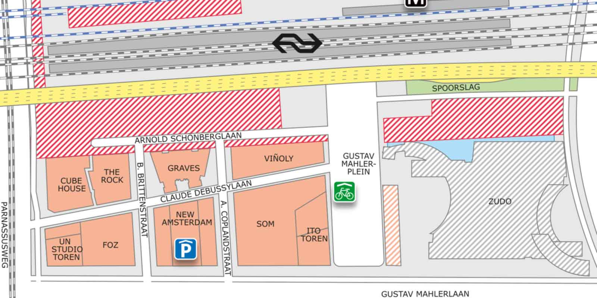

Aan de Zuidas bewandelen we de Claude Debussylaan. Beeldbepalende gebouwen zijn achtereenvolgens The Rock, Graves, Viñoly en het ABN AMRO-hoofdkantoor
## The Rock

Erick van Egeraat, ooit deel van het Delftse architectenbureau Mecanoo, ontwierp de indrukwekkende vuilverbranding/energiecentrale van Roskilde. Op de Zuidas bouwde hij onder de naam _The Rock_ een soort van rots.

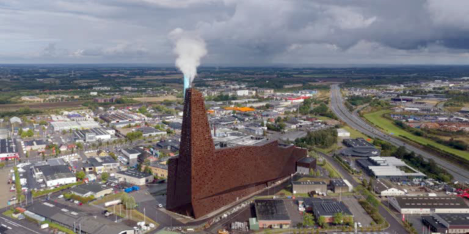
> _Roskilde Incineration Line_

## Graves

Dit gebouw, uitgevoerd in rood marmer en Dudok-baksteen, is genoemd naar zijn architect: Michael Graves.

Graves is ook degene die in 1998 twee ornamentele puntdaken liet plaatsen op het kantoorgebouw dat tot dan toe bekend stond als het _Transitorium_ en sindsdien als de _Haagse Tieten_.

Ook ontwierp hij het Louwman Museum (_Nationaal Automobiel Museum_), eveneens in Den Haag.

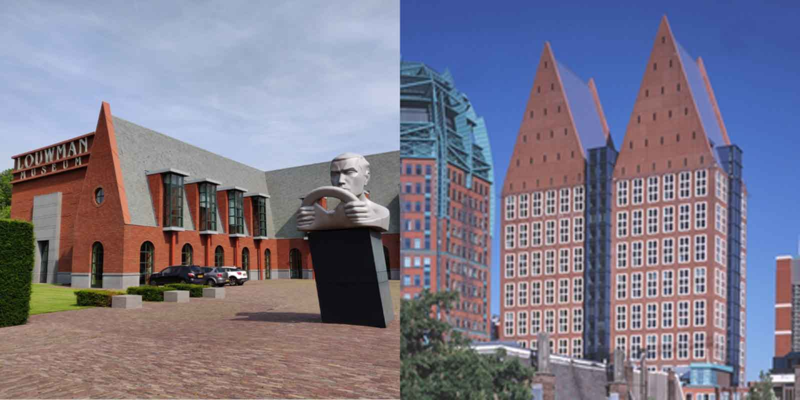

> _Louwman, Tieten_

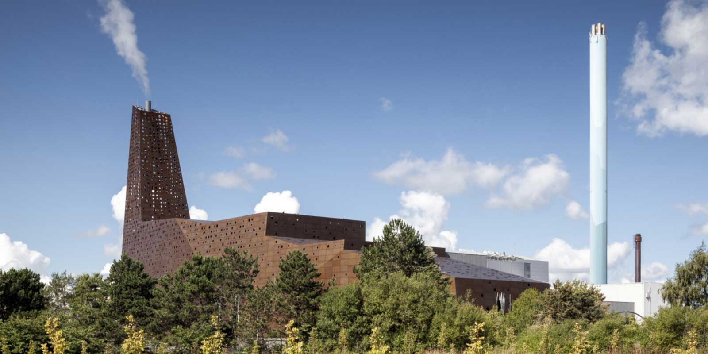
> _Roskilde Incineration Line_

## Viñoly

Blikvangers van dit door de Uruguayaanse architect Rafael Viñoly ontworpen kantoorgebouw aan de Zuidas zijn de in de gevel gekerfde trappen. Ze bleken te gevaarlijk om op te lopen en zijn dus al sinds de opening van het gebouw niet toegankelijk.

Andere gevaarlijke architectuur van Viñoly is het gezichtbepalende 20 Fenchurch Street in Londen (de "Walkie-Talkie"), dat door zijn gebogen vorm als een brandspiegel bleek te werken, wat leidde tot beschadigingen aan de lak van geparkeerde auto's en minstens één bekend geval van verschroeide deurmat.

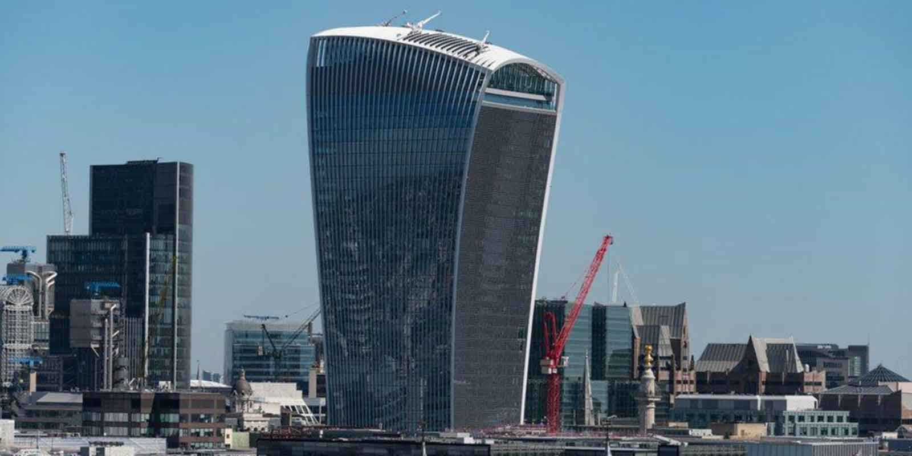
> _Walkie-Talkie_

## ABN AMRO-hoofdkantoor
Spannend: is het ABN AMRO-hoofdkantoor op de dag van onze wandeling nog steeds het hoofdkantoor van ABN AMRO? Net als de KLM maakt ABN AMRO al jaren gewag van een op handen zijnde verhuizing uit hun karbonkel van een hoofdkantoor. KLM gaat naar Schiphol-Oost; ABN AMRO naar de Bijlmer. De verkoop van het ABN AMRO-hoofdkantoor aan de Victory Group (765 miljoen) heeft inmiddels plaatsgevonden. ABN AMRO is nu niet meer eigenaar maar huurder in het 105 meter hoge gebouw. Andere 105 meter hoge gebouwen aan de Zuidas: _WTC Tower H_, _Amsterdam Symphony Toren I_ en _Amsterdam Symphony Toren II_. Wegens Schiphol mag het niet hoger.

# Route
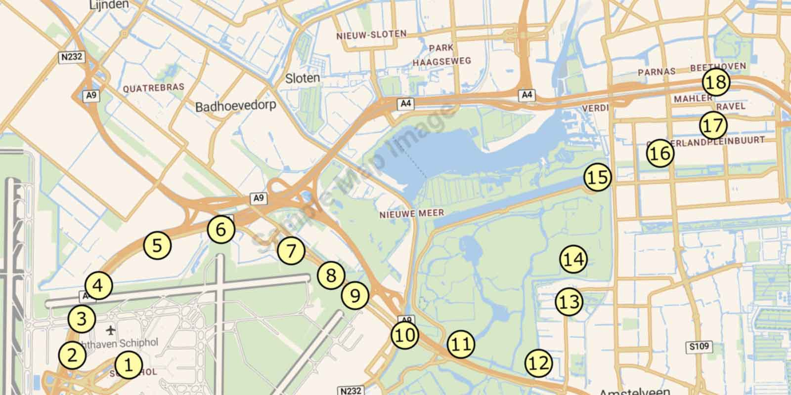
||routepunt|hoe ver is het nog?|
|-|-|-|
|1|Schiphol Plaza|15 km
|2|G-pier met reclamezuil|14 km
|3|Ingang Buitenvelderttunnel|13,5km
|4|Uitgang Buitenvelderttunnel|13 km
|5|Schiphol P3 langparkeerterrein| 12 km
|6|Hart van de Aalsmeerbaan|11 km
|7|Spottersplaats Buitenveldertbaan|10 km
|8|Hart van de Buitenveldertbaan|9,2 km
|9|Hart van de Oostbaan|9 km
|10|Schipholdraaibrug|8 km
|11|Bocht van Thijsse|7 km
|12|KLM-hoofdkantoor|6 km
|13|Geboortehuis|5 km
|14|VRA Cricket|4 km
|15|Bosbaan|3 km
|16|Woonhuis Joop den Uyl|2 km
|17|Hoofdgebouw Vrije Universiteit Amsterdam|1 km
|18|Zuidas / Station Amsterdam-Zuid|0 km
